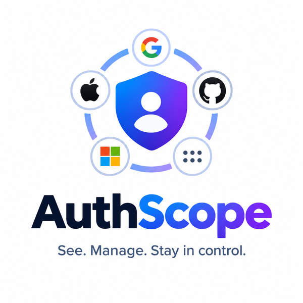

# AuthScope



*See. Manage. Stay in control.*

A browser extension that remembers which sites you signed in to or signed up for with a third-party provider: Google, Apple, GitHub, Microsoft, Facebook, X, LinkedIn, Discord, GitLab, Slack, Amazon, Twitch or Yahoo.

It deliberately doesn't record email/password, passkey or email-code sign-ins: your password manager already keeps track of those. Everything is stored in your browser only. Nothing about you or your ledger is sent anywhere. The only outside requests are for each provider's site icon (e.g. github.com/favicon.ico), which the dashboard and popup load from the provider's own website so you can recognise them at a glance.

Works in Chrome, Edge, Brave, Arc and other Chromium browsers, and in Firefox 140 or later.

**Get it:** [Firefox Add-ons](https://addons.mozilla.org/en-GB/firefox/addon/authscope/) · [Chrome Web Store](https://chromewebstore.google.com/detail/authscope/hhfbggbhabpmfmefghkaakkgchedlgje)

The packages for each version are also attached to this repository's [Releases](../../releases).

## Install in Firefox

Firefox only installs extensions permanently once Mozilla has signed them. Signing your own copy is free and automatic, and it stays private (it isn't listed in the add-on store).

**To try it now (removed when Firefox restarts):**
1. Go to `about:debugging#/runtime/this-firefox`.
2. Click **Load Temporary Add-on…** and pick `authscope-firefox.xpi`.

**To install it for good:**
1. Sign in at https://addons.mozilla.org/developers/ (any Firefox account).
2. Choose **Submit a New Add-on**, then **On your own**. This signs it for you without listing it publicly.
3. Upload `authscope-firefox.xpi`. The automatic review usually takes a few minutes.
4. Download the signed `.xpi` it gives you and open it in Firefox (or drag it onto a Firefox window).

**After installing:** if the dashboard shows "Allow AuthScope to see sign-in pages", click **Allow on provider sites**. Without that, Firefox stops it from noticing new sign-ins. You can also check this under `about:addons` → AuthScope → Permissions.


## Install in Chrome

1. Download `authscope-chrome.zip` from [Releases](../../releases) (or build it with `./build.sh`), then unzip it somewhere you'll keep it (Chrome loads it from that folder).
2. Go to `chrome://extensions` and turn on **Developer mode** (top right).
3. Click **Load unpacked** and choose the `authscope` folder.
4. Pin it: click the puzzle-piece icon in the toolbar, then the pin next to AuthScope.

The dashboard opens after installing with a short welcome guide. Click **Check all now** in it to fill your list from your Google, GitHub and other accounts; you'll see it count through them and then show what it found. The guide appears once and doesn't come back after you finish or skip it.

## Using it

- **On a login page**, the toolbar icon shows a small badge such as `G` (Google), `A` (Apple) or `GH` (GitHub). A `+` means more than one. Click the icon to see the details.
- **Dashboard** (right-click the icon → Options, or "All sites" in the popup): search, filter by provider, remove entries. The list shows 20 sites per page.
- **Check your accounts**: on the dashboard, click **Check all**. It opens each provider's connected-apps page (Google, GitHub, Microsoft, LinkedIn, Facebook, X, Discord, GitLab, Amazon, Twitch, Yahoo) in a background tab, reads the list of apps you've signed in to with it, closes the tab, and adds those apps to your ledger. Click a provider's app count (e.g. "25 apps") to see just its sites. For GitHub, only **Authorized OAuth Apps** are read; Authorized GitHub Apps are tools you've given access to your code, not sign-ins. If a provider no longer lists an app (for example you revoked it), the next check removes that provider's tag from it. Sign-ins AuthScope saw happen, or that you added by hand, are never removed by a check.

  For Google and GitHub, it also opens each app's page on that provider to find the app's website, so "Ollama" is filed as ollama.com. When you visit a site, the toolbar icon shows the provider you used for it. Sites are matched by:
  - the website the provider listed (Pinterest → pinterest.com)
  - the same name on another country domain (deliveroo.com also matches deliveroo.ie)
  - the app's name when no website is known (Ollama → ollama.com, Netlify Auth → netlify.com). Words like "Auth", "App" or "Group" are ignored when matching. Providers you aren't signed in to show **Sign in**: sign in there, then click **Check again**. Apple asks for your password on that page every time, so it's checked by hand: click **Open** to see your Apple sign-ins, then add them with **Add a site by hand** below the list.
- **Backups**: Export backup saves a JSON file you can import on another computer. Export as spreadsheet gives a CSV.

## How it detects sign-ins

- **Sign in with Google / Apple / GitHub / …**: it watches for the provider's sign-in page (including ones that bounce straight back because you'd already approved the site) and records which site sent you there.
- **Solid vs dashed tags**: solid means it saw you come back to the site signed in. Dashed means the sign-in started but it couldn't see it finish (for example, a popup that closed itself).
- **Sign-ups count too**: creating an account with "Sign up with Google" goes through the same provider page, so it's recorded the same way.
- **Not recorded**: signing in with an email and password, a passkey, or an emailed code. AuthScope doesn't run anything on the sites you visit to watch for these.

Cancelled sign-ins (you hit "Cancel" on Google's page) are not recorded.

## Sign-ins by provider

Once the ledger has sites, the dashboard shows a 3D pie of how many sites you sign in to with each provider (e.g. Google 25, GitHub 8). Click a slice, or a provider in the legend beside it, to list just those sites; click it again or **Show all sites** to go back. Drag sideways to turn the pie.

The four providers with the most sites get their own colours. Any more share a striped **Other** slice, because more than four colours can't be told apart reliably, especially with colour blindness, when every slice touches every other. The legend still lists each provider with its own count.

## Support AuthScope

If AuthScope is useful to you, you can support it on Ko-fi: https://ko-fi.com/varennck. There's a **Support AuthScope** button at the top of the dashboard and a **Donate** link in the toolbar popup. Both just open that page in a new tab; AuthScope never handles any payment itself.

## Permissions, and why

| Permission | Used for |
|---|---|
| Provider sites only (Google, Apple, GitHub, Microsoft, Facebook, X, LinkedIn, Discord, Slack, Twitch, GitLab, Yahoo, Amazon) | Notice when a site sends you to one of these providers to sign in, and read your connected-apps pages when you click Check. Unless you switch on the option below, AuthScope has no access to any other site and runs no script on the sites you visit |
| Tabs, web navigation, web requests | Notice provider sign-in pages and which site opened them, and update the badge |
| Storage | Keep your ledger on this device |
| Scripting | Read the app list on each provider's connected-apps page when you click Check |
| All sites (optional, off by default) | Only asked for if you switch on **Point at the button you used on sign-in pages** in Settings. On sites already in your list, AuthScope then outlines the sign-in button you used ("Continue with Google" and so on) with a "You used this" label. It only reads the page's buttons and sends nothing anywhere. Switching the option off gives the access back |

## Browsing history scan (switched off)

The extension can also scan your browsing history for past sign-ins, but this is switched off for now and the extension doesn't ask for history access. To turn it back on, set `HISTORY_SCAN = true` in `dashboard.js` and add `"history"` back to `permissions` in both manifests.

## Building

`./build.sh` makes both packages in `dist/` from the same source. The only difference is the manifest: `manifest.json` for Chrome, `manifest.firefox.json` for Firefox.

| File | Use |
|---|---|
| `dist/authscope-chrome-store.zip` | Upload to the Chrome Web Store |
| `dist/authscope-chrome.zip` | Unzip, then **Load unpacked** in `chrome://extensions` |
| `dist/authscope-firefox.xpi` | Upload to Firefox Add-ons |

There is no bundler, minifier or other build step: the files in the packages are the files in this repository.

## Tests

```
npm install
npx playwright install chromium
npm test
```

This runs the matching and URL-detection tests, then loads the extension in Chromium and walks through signing in, checking accounts, the chart, the donate links and the welcome guide. The provider pages it uses are fakes served from your own machine, so no real accounts are touched. It needs Node 18 or later and `openssl`.

## Project layout

| Path | What's there |
|---|---|
| `background.js` | Notices provider sign-in pages and updates the toolbar badge |
| `popup.*` | The toolbar popup |
| `dashboard.*` | The dashboard (options page) |
| `lib/` | Provider rules, storage, site matching and the account check |
| `ui/` | Shared styles, helpers and the 3D pie chart |
| `icons/`, `brand/`, `fonts/` | Images and the Atkinson Hyperlegible Next font |
| `tests/` | Automated tests |
| `site/` | The AuthScope website (published with GitHub Pages) |

## Upgrading from an older version

Earlier versions also saved password and passkey sign-ins. Version 3 removes those from your ledger the first time it starts; your provider sign-ins are kept.

## Limits

- Check your accounts reads each provider's page as it looks today. If a provider redesigns its page, that row may show "None found" or pick up odd entries until the reader is updated. Any odd entry can be removed from the ledger with its × button.

- Google's "One Tap" box (the little prompt in the corner of some sites) doesn't open a page, so it can't be seen. Those will show up when you check Google's connected apps page.
- Each browser profile keeps its own ledger. Use Export/Import to move it.

## Licence

AuthScope is released under the [Mozilla Public License 2.0](LICENSE). The Atkinson Hyperlegible Next font is under the SIL Open Font License ([fonts/OFL.txt](fonts/OFL.txt)).
